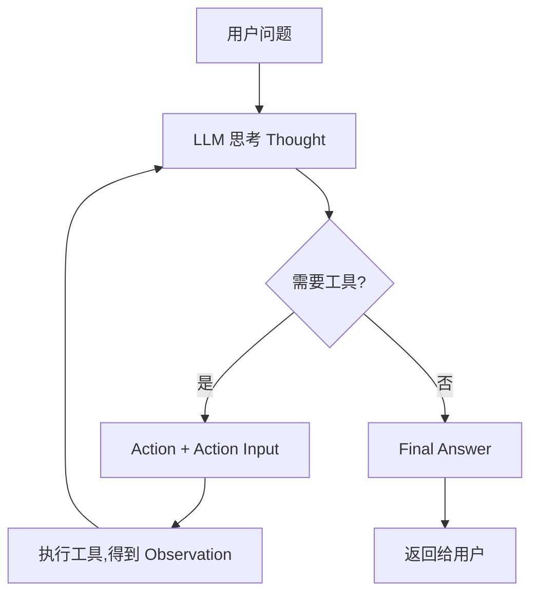

# 课时3:Go 实现 ReAct

> 目标:亲手实现"思考-行动-观察"循环,让 LLM 学会调用工具。

## 本课时学什么

- LLM 只会"说"不会"做",所以我们在外面套一个循环,把模型和工具接起来;
- ReAct = Reasoning + Acting,是 Agent 最经典的循环范式;
- 关键技巧:系统提示词里约定**文本协议**(Thought / Action / Action Input),
  框架解析并执行工具,把结果以 `Observation` 放回对话,模型继续思考。

## 目录结构

```text
ch03/
├── main.go        # 入口
├── llm.go         # LLM 客户端(课时1 的内容)
├── tools.go       # 工具注册表 + calculator / get_time 两个工具
├── agent.go       # 核心:ReAct 循环 + 文本协议解析
├── agent_test.go  # 用本地 mock LLM 测试,离线可跑
└── README.md
```

## 运行

```powershell
cd E:\codex\project001\ch03
go run . "12 * 8 + 4 等于多少?"
go run . "现在北京时间几点?"
```

你会看到完整循环的每一步:Thought → Action → Observation → Final Answer。

不联网也能验证逻辑:

```powershell
go test ./... -v
```

## ReAct 循环图



## 代码怎么组织

1. `buildSystemPrompt` 把"输出格式 + 工具列表"拼进 system 消息,告诉模型
   什么时候该输出 Action、输出什么工具名;
2. `runReAct` 是主循环:调 LLM → 检查有没有 `Final Answer` → 没有就解析
   `Action` → `Registry.Run` 执行工具 → 把 `Observation` 追加进对话 → 再来一轮;
3. `parseReAct` / `extractFinalAnswer` 用正则和花括号配对解析模型文本。

## 练习

1. 在 `tools.go` 里加一个 `random` 工具(返回随机数),注册后试试
   "给我一个 1 到 100 的随机数",观察模型会不会用;
2. 把 `maxIterations` 改成 2,问一个需要 3 步的问题,观察 Agent 怎么"认输";
3. 思考:如果模型输出了 `Action Input: {expression: "..."}`(参数名没加引号),
   Agent 会怎样?——这就是文本协议的脆弱点,也是课时4 里
   Function Calling(结构化工具调用)更稳的原因。

## 小结

到这里,你已经有一个"会调用工具"的 Agent 了。课时4 会把 SKILL、
MCP、Function Calling 全部装进来,组成完整的课程案例。
