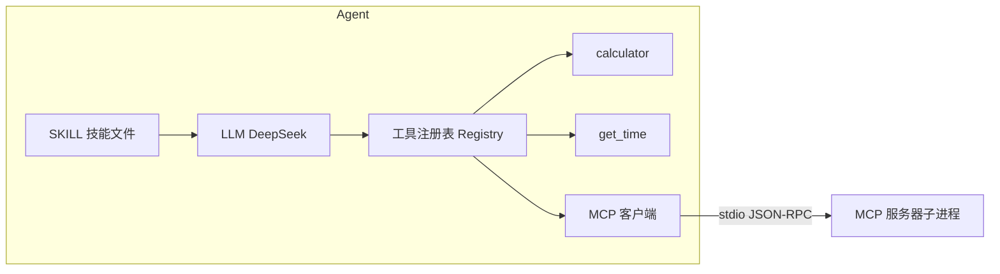

# 课时4:综合案例——完整 AI Agent

> 目标:把 LLM、提示词、ReAct 组装成一个完整 Agent,
> 并接入 SKILL / MCP,额外体验原生 Function Calling。

## 本课时学什么

- **组装**:LLM 负责"想",Tool 负责"做",Agent 用循环把两者接起来;
- **两种工具调用方式**:
  - `react`(默认):课时3 的文本协议循环;
  - `tool`:原生 Function Calling,模型返回结构化 `tool_calls`,更稳;
- **SKILL**:技能文件自动注入系统提示词(专章见课时5);
- **MCP**:可选接入,服务器通过 stdio 变成 Agent 的一个工具(专章见课时16);
- 一张图看懂最终架构:



## 目录结构

```text
ch04/
├── main.go            # 入口:模式选择(react/tool)、MCP 接入、SKILL 加载
├── llm.go             # LLM 客户端(课时1)
├── agent.go           # ReAct 循环 + Function Calling 循环
├── tools.go           # 工具注册表 + calculator / get_time
├── skills.go          # SKILL 加载(课时5)
├── mcpclient.go       # MCP 客户端(课时16)
├── mcp/server/main.go # MCP 服务器(课时16)
├── skills/            # 技能文件
└── react_test.go      # 离线测试(mock LLM + MCP)
```

## 运行

```powershell
cd E:\codex\project001\ch04

# 文本 ReAct 模式(课时3 的方式)
go run . "12 * 8 + 4 等于多少?"

# 原生 Function Calling 模式
go run . -mode tool "2 + 3 * 4 等于多少?"

# 接入 MCP:先手动启动服务器(终端 1),再跑 Agent(终端 2);默认地址均为 127.0.0.1:8765
go run ./mcp/server
go run . -mode tool "用 mcp 工具调用 echo,内容写 hello"
```


离线验证(不需要 API Key):

```powershell
go test ./... -v
```

## 两种模式对比

ReAct(文本):

- 不依赖 API 特性,任何对话模型都能跑;
- 格式靠约定,解析靠正则,模型偶尔会"跑偏",需要兜底提示。

Function Calling(原生):

- 工具定义(名字、说明、参数 Schema)直接发给模型;
- 模型返回结构化 `tool_calls`,参数是干净 JSON;
- 稳定、生产常用,要求模型支持 `tools` 参数(DeepSeek v4 两个模型都支持)。

## SKILL 与 MCP 在 Agent 里的位置

- SKILL 改的是**提示词**:`skills/*.md` 被拼进 system 消息,约束模型行为;
- MCP 接的是**工具**:`mcp` 是一个普通工具,转发到 MCP 服务器,
  服务器上的工具(echo 等)对 Agent 来说就像本地工具一样;
- 所以整套架构可以一句话概括:**LLM 负责想,Tool 负责做,
  SKILL 负责告诉模型怎么做,MCP 让工具即插即用。**

## 练习(综合题)

1. 给 MCP 服务器加一个 `multiply` 工具,再给 Agent 注册一个本地工具
   `random`,分别用 react 和 tool 两种模式问它;
2. 新增一个 `skills/poet.md`,观察它对计算问题的回答格式是否也受影响;
3. 把默认模型改成 `deepseek-v4-pro`,对比复杂多步任务的表现和速度;
4. 说出 Agent 在什么情况下会"陷入死循环",框架可以用哪些手段防止?
   (提示:maxIterations、Observation 里的错误信息、格式兜底。)

## 课程总结

回顾 Agent 内核几课:

| 课时 | 内容 | 一句话 |
|---|---|---|
| 1 | LLM | 模型只会"说",API 是通道 |
| 2 | 提示词工程 | 说明书写清楚,行为更可控 |
| 3 | ReAct | 思考-行动-观察的循环 |
| 4 | Agent | 把循环 + 工具 + SKILL/MCP 组装起来 |
| 5 | SKILL | 行为规范打包成提示词文件 |
| 16 | MCP | 工具的"USB-C",协议层(可后置) |

现在你可以回去修改任意一课,观察综合 Agent 的行为变化——这就是"组件化"的好处。
