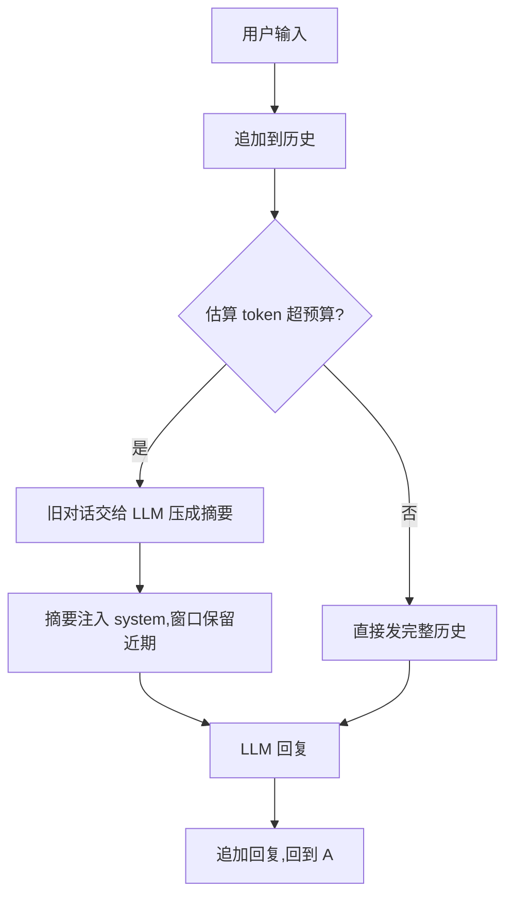

# 课时6:多轮对话与记忆

> 目标:解决 Agent 的两个真实问题——聊久了爆上下文、换会话就失忆。

## 本课时学什么

1. **上下文预算**:模型上下文有限、token 要花钱,历史不能无限堆;
2. **截断 + 摘要**:超过预算时,把旧对话交给 LLM 压缩成一段摘要(这就是"记忆");
3. **偏好持久化**:跨会话记住"用户喜欢什么",存成 JSON 文件;
4. **交互式 CLI**:一个真正能持续聊天的入口。

## 目录结构

```text
ch06/
├── main.go        # 交互式对话循环 + 命令处理
├── llm.go         # LLM 客户端(课时1 的内容)
├── memory.go      # History(截断/压缩) + Preferences(持久化)
├── memory_test.go # 离线测试:压缩、估算、持久化
└── README.md
```

## 运行

```powershell
cd E:\codex\project001\goagent\ch06
go run .
```

试试这个流程:

```text
你> 记住我喜欢喝咖啡
Agent> 好的,已记住。
你> 今天聊了 40 轮之后...(故意多聊,触发压缩)
你> 我喜欢喝什么?
Agent> 根据记忆,你喜欢喝咖啡。
```

聊天产生的 `memory.json` 就是 Agent 的"长期记忆"。

## 记忆是怎么工作的



关键点:`tokenEstimate` 只是粗略估算(中文 1 字 ≈ 1 token),够用来决定"何时压缩",
不需要精确。压缩失败时把旧消息放回去继续聊,不中断对话。

## 练习

1. 把 `summaryBudget` 从 3000 改成 300,多聊几句观察压缩触发;
2. 加一个 `/forget` 命令,清空偏好文件;
3. 想一想:摘要压缩会丢失细节,如果用户问"刚才那句话原话是什么"会怎样?
   业界怎么解决?(提示:分层的记忆——摘要 + 原文存档,课时 14 会做任务级的持久化。)

## 小结

记忆 = 窗口 + 摘要 + 持久化。这一课的 `History` 和 `Preferences`
在课时 8(RAG)和课时 5(综合 Agent)里可以直接复用。
