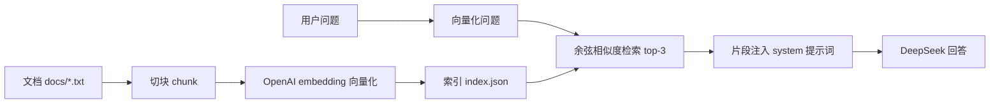

# 课时19:RAG——让 Agent 拥有私有知识

> 目标:让 Agent 回答"模型训练数据里没有"的问题——比如你们公司的内部制度。

## 本课时学什么

1. **RAG 是什么**:Retrieval-Augmented Generation(检索增强生成),
   先从私有文档里检索相关内容,再让 LLM 基于检索结果回答;
2. **为什么需要它**:模型不知道你的文档,直接问会"一本正经地编";
3. **路线 B**:DeepSeek 官方 API **没有 embedding 接口**,所以向量化交给
   OpenAI `text-embedding-3-small`(需要 `OPENAI_API_KEY`),"想"仍然由 DeepSeek 负责;
4. 完整流水线:切块 → 向量化 → 建索引 → 检索 → 注入提示词 → 回答。

## 流水线



## 目录结构

```text
ch19/
├── main.go         # 建索引 + 问答入口
├── embedder.go     # Embedder 接口 + OpenAIEmbedder(路线B)
├── vector.go       # 余弦相似度
├── rag.go          # 切块、索引构建/保存/检索
├── docs/sample.txt # 示例私有文档(虚构的公司制度)
├── rag_test.go     # 离线测试(切块/相似度/检索/mock embedding)
└── README.md
```

## 运行

```powershell
cd E:\codex\project001\goagent\ch19
go run . "员工生日当天可以休假吗?"
go run . "年假最多多少天?"
```

首次运行会用 `OPENAI_API_KEY` 给 `docs/sample.txt` 生成向量并保存到
`index.json`(之后秒开)。回答只来自检索到的资料,资料没有的会明确说
"资料中没有相关信息"。

离线测试:

```powershell
go test ./... -v
```

## 为什么"检索"比"全塞进去"好

文档可能几千页,不可能全部塞进提示词(上下文有限、还贵)。
检索只挑最相关的 3 段,既省 token 又更聚焦——这就是 RAG 的核心思想。

## 练习

1. 往 `docs/` 加一个新文件(比如"请假流程"),问一个只有新文件里有答案的问题;
2. 删除 `index.json` 重建索引,对比两次回答;
3. 把 `Search` 的 k 从 3 改成 1,观察回答质量下降;
4. 思考:检索结果本身可能包含错误信息或恶意内容,该怎么防?
   (提示:这就是课时12 要讲的提示注入防护。)

## 小结

RAG = 检索 + 生成。路线 B 把"向量化"外包给 OpenAI,换来的是课程无需本地
模型也能跑通真实架构;课时9 会在此基础上接真实向量数据库做混合检索。
