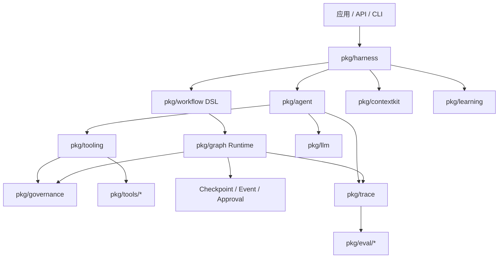

# Plan01：Go Agent 架构演进计划

## 1. 背景

随着 `goagent-new` 从基础 Agent 循环扩展到 Harness、Learning、Graph、Durable Runtime 和综合案例，现有架构已经具备完整教学链路，但也出现了下一阶段需要控制的边界问题：

1. `pkg/agent` 同时包含 Agent 循环、Tool 抽象、Tool 执行器和具体安全工具；
2. 审批、副作用、安全策略、API Token 和 Harness Capability 分散在不同层，尚未形成统一治理模型；
3. `pkg/workflow` 与 `pkg/graph` 分别维护状态、执行位置、幂等和持久化语义，继续独立增长会产生重复；
4. `pkg/eval` 与 `pkg/systemeval` 已出现 `Case`、`Outcome`、`Result` 和运行入口的重复。

本计划只定义后续演进顺序和验收标准，不要求立即进行大规模重构。

## 2. 总体判断与优先级

| 方向 | 判断 | 优先级 | 触发条件 |
|---|---|---:|---|
| Governance | 当前存在明确能力缺口 | P0 | 面向多用户、企业 API 或高风险 Tool 前必须完成 |
| Workflow / Graph 边界 | 当前已有重复，需要先定边界 | P0 | 两个运行时继续增加节点策略前完成 ADR |
| Tooling 抽离 | 方向正确，但应按依赖解耦实施 | P1 | 出现第三组业务 Tool 或 Tool 数量超过 8～10 个 |
| Eval 收拢 | 合理但主要是 API 与命名空间整理 | P2 | 对外发布稳定 API 或新增更多评估类型前 |

## 3. 演进原则

- 不做一次性大爆炸重构；新接口与兼容适配器先落地，再逐个迁移调用方；
- 不以目录数量作为主要优化指标，以职责、依赖方向和可测试性作为判断标准；
- Prompt 注入检测和敏感词检测只能产生风险信号，不能替代授权、隔离和资源作用域；
- 用户凭据不得进入 Prompt、模型可见上下文或普通 Tool 参数；
- Workflow 与 Graph 的区别不能定义为“确定性与非确定性”；
- 持久化恢复不等于外部副作用 exactly-once，外部系统仍必须支持幂等；
- 每个阶段必须保持 `go test ./...`、`go vet ./...` 和关键包 race test 通过；
- 现有 ch00～ch21 的教学入口在迁移期间保持可运行。

## 4. 目标架构



目标依赖方向：

```text
应用层
  ↓
Harness / Agent / Workflow DSL
  ↓
Graph Runtime / Tooling / Governance
  ↓
LLM、Tool 实现、持久化和外部系统 Adapter
```

底层包不能反向依赖具体业务 Tool 或具体应用。

## 5. 阶段 0：架构决策记录（ADR）

### 目标

先固定术语和包边界，避免多个重构并行发生。

### 任务

- [ ] 新增 `docs/adr/`；
- [ ] ADR-001：Agent、Harness、Tooling 的职责与依赖方向；
- [ ] ADR-002：Governance、Guardrail、Approval 的区别；
- [ ] ADR-003：Workflow DSL 与 Graph Runtime 的定位；
- [ ] ADR-004：Eval 包的公共模型与子包边界；
- [ ] 记录兼容策略和弃用周期；
- [ ] 为每个目标包画出允许和禁止的依赖关系。

### 验收标准

- README、章节讲义和 ADR 对同一概念使用一致术语；
- 明确哪些接口是课程 API，哪些只是示例内部实现；
- 阶段 1～4 的改动不再需要重新争论核心包边界。

## 6. 阶段 1：建立 `pkg/governance`

### 目标

把身份、资源、风险、策略决策、审批和审计统一为模型不可绕过的治理入口。

### 建议模型

```go
type Principal struct {
    TenantID string
    UserID   string
    Roles    []string
}

type Action struct {
    Principal Principal
    Tool      string
    Operation string
    Resource  string
    Risk      RiskLevel
    ArgsHash  string
}

type Decision struct {
    Effect Effect // allow / deny / require_approval
    Policy string
    Reason string
}
```

### 任务

- [ ] 定义 `Principal`、`Action`、`Resource`、`RiskLevel`、`Decision`；
- [ ] 定义 `PolicyEngine.Evaluate(ctx, action)`；
- [ ] 定义 `AuditSink.Record(decision)`；
- [ ] 把 Principal 放入受控 `context.Context`，但禁止把原始 Token 放入模型上下文；
- [ ] 提供 `agent.Approver` 到 Governance Decision 的兼容 Adapter；
- [ ] 将写入、外部调用、删除等动作映射为明确风险等级；
- [ ] 为 RequireApproval 定义可持久化的 Approval Request ID；
- [ ] 定义 Credential Broker 接口，按 Principal、Resource 和 Scope 获取短期凭据；
- [ ] 输出治理决策的 trace event，但对参数和凭据进行脱敏；
- [ ] 增加 Allow、Deny、RequireApproval、跨租户拒绝和 Token 不泄漏测试。

### Guardrail 边界

Input/Output 检测可以作为 `ContentSignal` 或 `RiskSignal`：

- 敏感信息检测；
- Prompt 注入启发式检测；
- 数据分类；
- 输出脱敏；
- 合规关键词标记。

这些信号必须交给 Policy Engine 决策，不能直接宣称“已防止 Prompt 注入”。

### 验收标准

- 任何有副作用的 Tool 都必须经过 Governance；
- Policy 决策包含 Principal、Resource、Effect、Policy 和 Reason；
- 高风险动作可以持久化挂起，而不是只支持同步 `bool` 审批；
- 用户 Token 不进入 Prompt、trace 明文或 Tool JSON 参数；
- 默认策略是 fail closed。

## 7. 阶段 2：抽离 Tooling 与具体 Tool

### 目标

让 `pkg/agent` 只负责模型和 Tool Call 循环，不随业务 Tool 数量增长。

### 目标目录

```text
pkg/
├── tooling/
│   ├── definition.go       # 供应商无关的 Tool Definition
│   ├── registry.go         # 注册、查找和能力清单
│   ├── validation.go       # 参数严格解码和 Schema 校验
│   ├── executor.go         # 超时、并发、缓存、幂等
│   └── policy_adapter.go   # Governance 接入点
└── tools/
    ├── calculator/
    ├── workspace/
    ├── httpapi/
    ├── cli/
    └── sandbox/
```

### 关键设计

- `tooling.Definition` 不直接返回 `llm.ToolDefinition`；
- LLM Adapter 负责把供应商无关 Schema 转换为模型协议；
- `agent` 声明自己消费的最小 `ToolProvider` 接口；
- Tool 实现依赖 `tooling`，不能依赖 Agent Runner；
- Governance 在执行器中统一决策，具体 Tool 不自行复制 RBAC；
- Python、CLI 和网络 Tool 使用隔离 Runner，不接受拼接 Shell 字符串。

### 迁移顺序

- [ ] 建立 `pkg/tooling` 的最小类型和 Registry；
- [ ] 添加 `agent` 与 `tooling` 的兼容 Adapter；
- [ ] 先迁移 Calculator，验证无外部副作用路径；
- [ ] 迁移 Workspace 只读工具；
- [ ] 迁移 Workspace 写工具并接入 Governance；
- [ ] 迁移 MathAI Graph Tool；
- [ ] 将具体工具放入 `pkg/tools/*`；
- [ ] 保留旧构造函数的临时兼容层；
- [ ] 全部调用方迁移后，再弃用 `agent/safe_tools.go`。

### 验收标准

- 新增业务 Tool 不需要修改 `pkg/agent`；
- Tool Schema、严格参数校验和执行策略可分别测试；
- 同一 Tool 可以被 Agent、Workflow 或 Graph 节点复用；
- LLM Provider 更换不要求修改 Tool 实现；
- 写和外部 Tool 无法绕过 Governance。

## 8. 阶段 3：明确 Workflow 与 Graph 的关系

### 最终定位

```text
Workflow = 面向业务的线性声明式 DSL
Graph    = 通用执行拓扑和状态运行时
Durable  = 两者共用的 checkpoint、event、approval、retry 语义
```

Workflow 不以“确定性代码”作为边界。Workflow 和 Graph 节点都可以执行确定性逻辑、Tool 或 LLM。

### 先补 Graph 能力

- [ ] `WaitingApproval` / `Paused` 状态；
- [ ] 节点级 Retry Policy；
- [ ] Pause Reason 和 Resume Input；
- [ ] Durable Timer；
- [ ] Worker Lease / Heartbeat 接口；
- [ ] 节点执行 Attempt ID；
- [ ] 状态版本迁移；
- [ ] Checkpoint 条件写接口；
- [ ] 事件序号和 Replay 语义。

### 再收敛重复实现

- [ ] 盘点 Workflow 与 Graph 重复的 Status、State、Event、Checkpoint；
- [ ] 抽取共享持久化协议，暂不强制共享同一个业务 State；
- [ ] 为现有 Workflow 编写等价 Graph 测试；
- [ ] 实现 Workflow DSL 到 Graph Definition 的编译器；
- [ ] 保留 `workflow.NewState` 等兼容入口；
- [ ] 使用 ch08 的审批恢复场景进行回归；
- [ ] 使用 ch19 的崩溃恢复场景验证外部幂等；
- [ ] 迁移完成后，Workflow 不再维护独立执行引擎。

### 验收标准

- Workflow 场景和编译后的 Graph 路径、审批和最终状态一致；
- 暂停后重启进程可以继续审批节点；
- Retry 不会重复已成功的外部副作用；
- Graph Definition 升级具备显式迁移；
- ch08、ch18、ch19、ch21 全部通过兼容测试。

## 9. 阶段 4：收拢 Eval 命名空间

### 目标

统一基础 Case、Result、Report 和比较语义，同时保留不同评估层次的独立依赖。

### 建议目录

```text
pkg/eval/
├── case.go
├── result.go
├── assertions/
├── trajectory/
└── system/
```

- `trajectory`：回答、Tool 轨迹和最终状态；
- `system`：Graph 路径、Harness 预算、故障注入和版本回归；
- `assertions`：可复用的 Path、State、Cost、Violation 断言；
- `system` 可以依赖 `graph`，但 `graph` 不得依赖 `eval`。

### 任务

- [ ] 定义公共 Case ID、Result、Failure Reason 和 Report Metadata；
- [ ] 明确 Outcome 是否共用，避免制造万能巨型结构；
- [ ] 将 `pkg/eval` 现有逻辑迁移到 `eval/trajectory`；
- [ ] 将 `pkg/systemeval` 迁移到 `eval/system`；
- [ ] 抽取 Fault Plan 和 Regression Comparison；
- [ ] 提供旧 import path 的过渡策略；
- [ ] 更新 ch07 与 ch20 文档和示例；
- [ ] 确保评估数据格式具有版本号。

### 验收标准

- 公共元数据和结果格式不重复；
- Trajectory 与 System 评估仍能独立使用；
- 缺失候选案例被识别为回归；
- Fault Injection 保持确定性；
- 旧课程在迁移期仍可运行。

## 10. 推荐执行顺序

```text
ADR
 ↓
Governance contracts
 ↓
Tooling + Governance execution integration
 ↓
Graph pause / approval / retry
 ↓
Workflow DSL 编译到 Graph
 ↓
Eval namespace 整理
```

不能先把具体 Tool 移出 `agent`，再事后补 Governance，否则所有新 Tool 可能形成不同的授权入口。

## 11. 课程影响范围

| 章节 | 未来调整 |
|---|---|
| ch03 | 使用 ToolProvider Adapter，保留最小 Agent 循环教学目标 |
| ch04 | Tool Runtime 逐步迁移到 `pkg/tooling` |
| ch07 | 迁移到 `pkg/eval/trajectory` |
| ch08 | Workflow 作为 Graph 上层 DSL 的教学入口 |
| ch09 | 增加 Governance 威胁模型，但不把检测器当安全边界 |
| ch13 | Workspace Tool 迁移并接入 Principal/Policy |
| ch15 | Harness 传递 Principal、Budget 和 Capability |
| ch18 | Graph 增加 Pause、Approval 和 Retry |
| ch19 | 增加租约、条件写、事件序号和 Replay |
| ch20 | 迁移到 `pkg/eval/system` |
| ch21 | RepoPilot 使用统一 Tooling 和 Governance |

迁移应更新代码链接和讲义，但不能改变各章原本的学习目标。

## 12. 风险与回滚

### 主要风险

- 包移动造成大量 import path 破坏；
- Tool 类型迁移引入 `llm ↔ tooling` 循环依赖；
- Workflow 编译为 Graph 后改变原有恢复语义；
- Governance 默认策略配置错误导致越权或全部拒绝；
- Eval 类型过度统一，形成难以扩展的巨型 Outcome；
- 兼容层长期不删除，形成双运行时。

### 控制方法

- 每阶段单独提交，禁止跨阶段混合重构；
- 新旧实现使用相同 fixture 做差分测试；
- 默认拒绝未知 Principal、Resource、Risk 和 Policy；
- 兼容层必须标记弃用条件，而不是只写 TODO；
- 每次迁移后运行全仓测试、race test、vet 和课程示例；
- 在删除旧入口前保留一个完整发布周期。

## 13. 暂不处理项

- 不因为增加 Governance 就立即引入外部策略引擎；
- 不把所有 Tool 强制部署成远程服务；
- 不把 Graph 改造成多 Agent 框架；
- 不加入无法验证效果的 Prompt 注入“万能检测器”；
- 不实现原始用户 Token 向模型或 Tool 参数透传；
- 不为了减少 `pkg` 根目录数量合并无关职责；
- 不在 Graph 缺少持久化审批前删除现有 Workflow Engine；
- 不在没有回归数据时自动迁移全部课程。

## 14. 完成定义

本计划全部完成需要同时满足：

1. `pkg/agent` 不再包含具体业务 Tool；
2. 所有副作用动作都经过统一 Governance Decision；
3. Principal 和资源作用域贯穿 API、Harness、Graph 和 Tooling；
4. Workflow 是 Graph 的声明式上层入口，不再拥有重复运行时；
5. Graph 支持持久化暂停、审批、重试、恢复和版本迁移；
6. Eval 使用统一命名空间和公共结果元数据；
7. ch00～ch21 全部示例和测试保持通过；
8. 不降低路径安全、参数严格校验、幂等和审批等现有安全保证；
9. 架构依赖方向通过文档和自动检查共同约束；
10. 完成迁移说明、兼容说明和弃用清单。

## 15. 当前建议

近期只启动阶段 0 和阶段 1：先完成 ADR 与 Governance 契约。Tooling、Workflow/Graph 和 Eval 的目录重构应在契约稳定后分阶段进行，避免为了结构整洁破坏当前已通过测试的教学主线。
