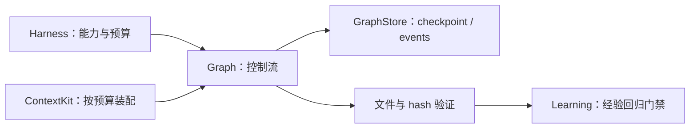

# ch21：RepoPilot 综合案例

RepoPilot 把 ch15～ch20 组装成一个受控的代码变更任务：检查文件、装配上下文、制定计划、等待审批、原子修改、验证结果，最后生成等待更多证据与回归验证的候选经验。

## 运行

默认不批准写入，只会走 denied 路径：

```bash
go run ./ch21-repopilot
```

复制教学工作区后再运行写入示例，避免修改仓库 fixture：

```bash
cp -r ch21-repopilot/testdata/workspace data/repopilot-workspace
go run ./ch21-repopilot -workspace data/repopilot-workspace -approve
```

测试：

```bash
go test ./ch21-repopilot -v
```

## 组合关系



执行图为：

```text
inspect → plan → approval ──批准──→ patch → verify
                         └─拒绝──→ denied
```

## 安全边界

- 只接受工作区内的相对路径，并逐段检查、拒绝符号链接；
- 只修改不超过 64 KiB 的普通文件；
- 仓库内容以 untrusted context 加载；
- 只有 promoted 历史经验会按项目 scope 检索，并仍作为数据而非高优先级指令；
- Planner 不能改变已授权的文件、旧文本、新文本和预期 hash；
- 写入前检查文件是否在 inspect 后发生变化；
- 使用同目录临时文件、flush、close、rename 替换；
- 未批准请求走独立终止节点，不调用写逻辑；
- patch 节点带幂等键，并能识别已经应用的结果；
- 修改成功后仍要读取文件并验证；
- 单次验证成功只生成 candidate 经验；积累独立证据并通过回归后才能晋级。

教学版本的 Planner 是确定性的。练习是将它替换为使用 `pkg/llm` 的结构化 Planner，但必须保留代码侧授权边界和所有验证。
