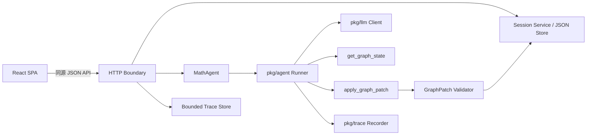

# 架构设计

## 组件边界

| 层 | 责任 | 不负责 |
|---|---|---|
| HTTP | 认证、限流、请求大小、超时、错误映射 | 数学规则 |
| MathAgent | 构建消息、注册工具、运行 Agent、生成 trace | 持久化提交 |
| Graph 工具 | 严格解码、调用领域操作 | 自己访问数据库 |
| 领域层 | 表达式与 GraphState 不变量、原子补丁 | LLM 和 HTTP |
| Store | 原子文件替换、版本冲突、会话 CRUD | 调用模型 |
| React | 交互与可信状态展示 | 安全校验 |

## 关键决策

### 每次请求创建 Executor

工具闭包只持有当前请求的 `working GraphState`。这样不会把不同会话的状态放进全局工具实例，也不需要在工具内查找 session id。请求结束后闭包自然释放。

### JSON 文件而非数据库

案例使用标准库、原子临时文件替换和进程内互斥锁，便于学习和单实例部署。它不是多实例方案；需要横向扩展时，将 Store 接口替换为支持事务/版本条件更新的数据库。

### Trace 与业务提交分离

只有会话成功提交后，trace 才放入有界内存 Store。Trace 用于近期调试，不是永久审计日志。生产环境可导出到 OpenTelemetry 或日志平台。

### 单容器同源部署

Go 同时托管 `/api` 和前端静态文件，浏览器默认不需要 CORS。`MATHAI_ALLOW_ORIGIN` 只服务于明确分离的开发或部署拓扑，不允许通配符。

## 可扩展点

- 将 `ChatProcessor` 替换为 scripted fake，API 可完全离线测试；
- 将 `llm.Client` 替换为其他 OpenAI-compatible 客户端；
- 将 Store 抽象为 PostgreSQL，保留版本条件提交语义；
- 将 Canvas 渲染器替换为 WebGL，不改变后端 GraphState；
- 增加 SSE 时，先流式发送文本事件，最终状态仍只做一次原子提交。
