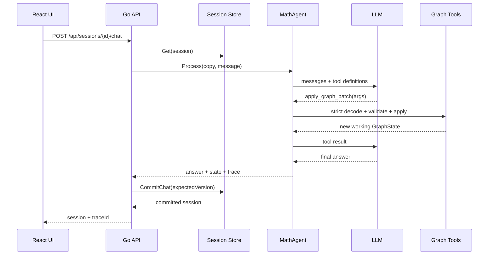

# 学习指南：把课程组件组装成真实产品

## 1. 先区分三种状态

MathAI 中有三种容易混淆的状态：

1. **会话状态**：用户与 assistant 的历史消息；
2. **领域状态**：函数、视口、渲染设置和分析；
3. **Agent 临时状态**：一次请求中，工具连续执行后尚未提交的工作副本。

LLM 调用可能耗时几十秒，因此后端不能在调用期间一直持有存储锁。`Process` 先复制会话状态，在副本上运行工具；完成后 `CommitChat` 使用 `expectedVersion` 原子提交。若期间其他请求已提交，则返回冲突而不是覆盖新数据。

## 2. 模型不是数据库写入接口

旧式实现常让模型“输出完整 JSON”，然后直接把 JSON 当作新状态。它有三个问题：模型容易遗漏字段、覆盖其他更新，且难以按副作用审计。

本案例把写入收敛为 `apply_graph_patch`：

- JSON decoder 拒绝未知字段；
- `ApplyGraphPatch` 在副本上执行，全部通过后才返回；
- 每个操作都有清晰语义，如 `add_equation`、`set_viewport`；
- 写工具经过 `pkg/agent` 的审批路径；
- trace 记录工具名称、状态、耗时和幂等键。

这里的 Approver 只自动批准当前会话内、可验证且可通过删除会话恢复的图形补丁。它不会批准文件、网络或系统写入。若以后加入“分享图形”“发送邮件”等外部副作用，应改成显式用户确认。

## 3. 一次请求的执行过程

## 4. 前端为什么使用 Canvas + mathjs

Canvas 足以展示一元函数，也让课程代码保留核心算法：世界坐标到屏幕坐标的转换、采样、网格、断点判断和高 DPI 处理。表达式通过 `mathjs.compile` 解释，不使用 JavaScript `eval` 或 `new Function`。

后端白名单是安全边界，前端解析只是渲染层。即使用户绕过前端，非法表达式仍无法进入持久化状态。

## 5. 建议练习

1. 给 `GraphPatch` 增加 `duplicate_equation`，先写失败测试再实现；
2. 为前端加入拖拽和滚轮缩放，并通过 API 保存视口；
3. 将内存 trace store 换成带 TTL 的外部存储；
4. 用 `testdata/eval-cases.json` 写一个离线评估器，评分维度包括工具选择和最终状态；
5. 增加真实用户审批：模型建议清空图形时，在 UI 中展示待审批操作。

## 6. 不应继续堆叠的内容

- 不需要为两个图形工具引入多 Agent；
- 不需要为了“记忆”再加向量数据库，会话状态已经足够；
- 不应把表达式验证交给提示词；
- 不应为了流式文字破坏图形状态的原子提交；
- 不应在没有评估集之前宣称提示词已经优化。
